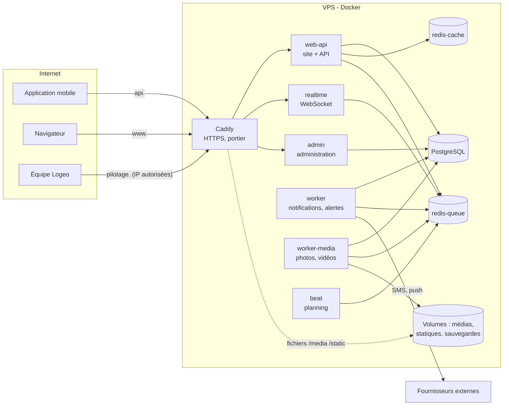
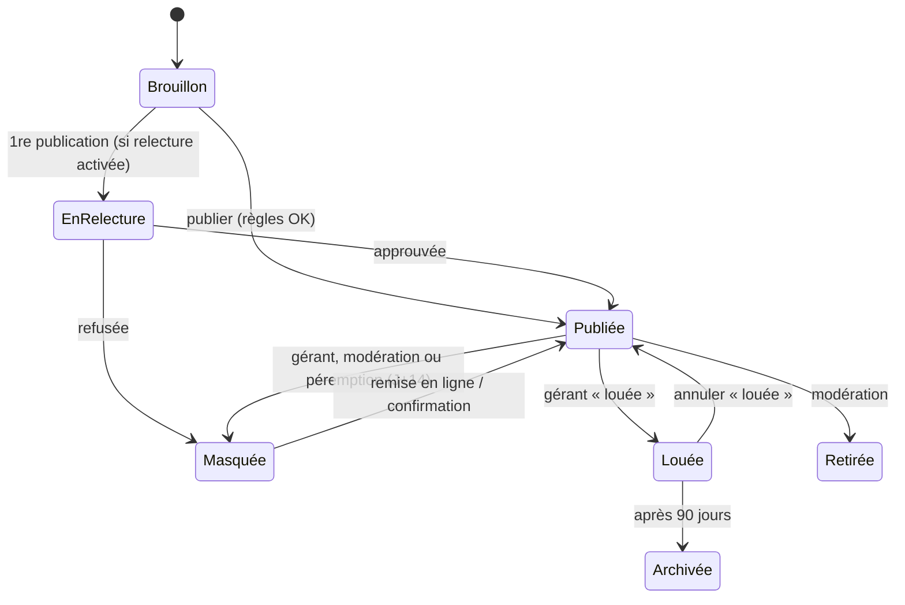

# Comprendre Logeo de A à Z

> Ce document explique **tout le projet** à quelqu'un qui ne l'a jamais ouvert : ce que fait chaque partie, pourquoi
> elle existe, comment elle fonctionne, quand elle intervient, comment les morceaux se parlent, comment ils sont
> protégés, et ce qu'il faut surveiller. Il est écrit pour être relu et expliqué à d'autres.
>
> État décrit : octobre 2026, branche `feat/refonte-design-web`. Quand le code change, ce document doit suivre.

---

## Sommaire

1. [Logeo en une page](#1-logeo-en-une-page)
2. [Petit lexique](#2-petit-lexique)
3. [L'architecture en une image](#3-larchitecture-en-une-image)
4. [Trois histoires pour tout comprendre](#4-trois-histoires-pour-tout-comprendre)
5. [Docker : les 12 conteneurs et leur rôle](#5-docker--les-12-conteneurs-et-leur-rôle)
6. [Comment les choses sont isolées](#6-comment-les-choses-sont-isolées)
7. [La base de données PostgreSQL](#7-la-base-de-données-postgresql)
8. [Redis : deux mémoires rapides](#8-redis--deux-mémoires-rapides)
9. [Les tâches de fond (Celery) et le planning](#9-les-tâches-de-fond-celery-et-le-planning)
10. [Caddy, la porte d'entrée](#10-caddy-la-porte-dentrée)
11. [Le serveur Django : organisation du code](#11-le-serveur-django--organisation-du-code)
12. [Chaque fonctionnalité, expliquée](#12-chaque-fonctionnalité-expliquée)
13. [Le site web](#13-le-site-web)
14. [L'administration](#14-ladministration)
15. [L'application mobile](#15-lapplication-mobile)
16. [La sécurité : chaque protection et pourquoi](#16-la-sécurité--chaque-protection-et-pourquoi)
17. [Les fournisseurs interchangeables](#17-les-fournisseurs-interchangeables)
18. [La qualité : tests, contrôles, garde-fous](#18-la-qualité--tests-contrôles-garde-fous)
19. [Configuration et secrets](#19-configuration-et-secrets)
20. [Les commandes du quotidien](#20-les-commandes-du-quotidien)
21. [Ce qu'il faut surveiller](#21-ce-quil-faut-surveiller)
22. [Carte des fichiers importants](#22-carte-des-fichiers-importants)
23. [Pour aller plus loin](#23-pour-aller-plus-loin)
24. [Avis et recommandations](#24-avis-et-recommandations)

---

## 1. Logeo en une page

**Le problème.** À Parakou, un étudiant cherche une chambre en passant par des groupes WhatsApp, des démarcheurs et
des visites inutiles. On lui demande parfois de payer avant d'avoir vu la chambre.

**La réponse de Logeo.** Une plateforme où :

- les **gérants** (propriétaires ou gestionnaires) publient leurs chambres **avec une vidéo**, après avoir été
  **vérifiés** par l'équipe ;
- les **locataires** (surtout des étudiants) cherchent par quartier, budget et type, regardent la vidéo, écrivent au
  gérant et créent des **alertes** pour être prévenus quand une chambre correspond ;
- l'**équipe Logeo** modère, vérifie les gérants et règle la plateforme depuis une **administration**.

**Trois façons d'y accéder, un seul cerveau :**

| Surface | Pour qui | Adresse (en ligne) | Technologie |
|---|---|---|---|
| Site web | Visiteurs, locataires, gérants | `www.<domaine>` | Pages Django |
| Application mobile | Locataires, gérants | Android et iPhone | React Native (Expo) |
| Administration | Équipe Logeo seulement | `pilotage.<domaine>` | Admin Django personnalisée |

Le site et l'application parlent au **même serveur** et à la **même base de données**. Une chambre publiée depuis
l'application apparaît aussitôt sur le site, et inversement.

**Le modèle économique** (décidé, pas encore activé) : abonnement des gérants et, plus tard, alertes payantes pour les
locataires. Tout est **prêt dans le code mais éteint** (réglages `SUBSCRIPTION_ENABLED` et `PAID_ALERTS_ENABLED`) : en V1,
rien n'est payant et aucun écran de paiement n'est visible.

---

## 2. Petit lexique

| Mot | Explication simple |
|---|---|
| **Serveur** | L'ordinateur (et les programmes) qui répond aux demandes du site et de l'application. |
| **API** | Le « guichet » du serveur pour l'application mobile : on lui envoie une demande (« donne-moi les chambres de Zongo »), il répond en données (JSON). Toutes ses adresses commencent par `/v1/`. |
| **Base de données (PostgreSQL)** | Le registre permanent : comptes, chambres, messages… Rien ne s'y perd au redémarrage. |
| **Redis** | Une mémoire ultra-rapide pour ce qui est temporaire ou très fréquent : compteurs, files d'attente, cache. |
| **Cache** | Une copie temporaire d'un résultat pour ne pas le recalculer à chaque fois (ex. la page du fil, 60 s). |
| **Conteneur (Docker)** | Une boîte fermée qui contient un programme et tout ce dont il a besoin. Logeo tourne dans douze boîtes qui communiquent entre elles. |
| **Volume** | Un disque attaché à un conteneur, qui survit quand on le redémarre (base, médias, sauvegardes). |
| **Tâche de fond** | Un travail fait « en coulisses », sans faire attendre l'utilisateur (convertir une vidéo, envoyer une notification). |
| **File d'attente** | La liste des tâches de fond à faire ; des « ouvriers » (workers) les prennent une par une. |
| **WebSocket** | Une ligne ouverte en permanence entre l'application et le serveur, pour recevoir les messages instantanément. |
| **Jeton (token)** | Un badge numérique qui prouve qui tu es, sans renvoyer ton mot de passe à chaque fois. |
| **OTP** | « One-Time Password » : le code à 6 chiffres reçu par SMS pour prouver qu'un numéro t'appartient. |
| **Hachage** | Transformer une donnée en empreinte impossible à inverser. On stocke l'empreinte d'un mot de passe, jamais le mot de passe. |
| **Migration** | Un script qui fait évoluer la structure de la base (ajouter une colonne, une table…), joué une seule fois. |
| **Push** | Une notification qui arrive sur le téléphone même quand l'application est fermée. |
| **Proxy inverse (Caddy)** | Le portier : il reçoit toutes les visites venant d'Internet et les dirige vers le bon conteneur. |
| **ADR** | « Architecture Decision Record » : une page qui note une décision technique importante et sa raison (`docs/adr/`). |
| **CDC** | Le cahier des charges (`docs/cahier-des-charges.md`), la référence fonctionnelle. |

---

## 3. L'architecture en une image

Pense à **un immeuble de bureaux** :

- **Caddy** est l'accueil au rez-de-chaussée : il reçoit tout le monde, vérifie l'adresse et oriente.
- **web-api** est le grand guichet : site web et API de l'application.
- **realtime** est le standard téléphonique : il garde les lignes ouvertes pour la messagerie instantanée.
- **admin** est un bureau fermé à clé, réservé à l'équipe.
- **worker** et **worker-media** sont les employés de l'arrière-boutique (notifications, vidéos).
- **beat** est le réveil qui lance les tâches à heure fixe.
- **PostgreSQL** est l'armoire forte des archives.
- **redis-cache** et **redis-queue** sont les tableaux blancs et les bannettes de courrier.



**L'idée clé : un « monolithe modulaire ».** Un seul code serveur (Django), une seule base de données, mais découpé en
**applications indépendantes** (comptes, annonces, messagerie…) et lancé en **plusieurs processus spécialisés**. C'est
plus simple à exploiter que des dizaines de petits services, tout en gardant des frontières nettes (vérifiées
automatiquement, voir §18).

---

## 4. Trois histoires pour tout comprendre

### Histoire 1 : Awa ouvre la fiche d'une chambre sur l'application

1. L'application envoie `GET https://api.logeo.bj/v1/listings/chambre-salon-…`.
2. **Caddy** reçoit la demande en HTTPS, vérifie qu'elle commence par `/v1/` et la passe à **web-api**.
3. **web-api** cherche la chambre dans **PostgreSQL** (sans jamais lire l'adresse privée ni le numéro du gérant).
4. Il répond en JSON : titre, loyer, quartier, liste des photos et de la vidéo (des **adresses** de fichiers).
5. L'application affiche la fiche, puis télécharge les photos : `https://api…/media/listings/…/w960.webp`. Ces
   fichiers sont servis **directement par Caddy** depuis le disque, sans déranger Django.
6. En parallèle, l'application dit « j'ai vu cette fiche » (`POST …/views`). Le serveur note la vue dans
   **redis-queue** (une seule fois par visiteur et par jour). Toutes les 5 minutes, **beat** demande à un **worker**
   de recopier ces compteurs dans la base (table `daily_stats`). C'est ce qui alimente les statistiques du gérant.

### Histoire 2 : Awa écrit au gérant

1. Awa tape un message et appuie sur « Envoyer ». L'application l'ajoute d'abord à sa **file d'envoi** locale
   (`outbox`), avec un identifiant unique créé sur le téléphone.
2. Elle envoie `POST /v1/conversations/{id}/messages` à **web-api**. Si le réseau coupe, elle renverra plus tard
   **le même identifiant** : le serveur reconnaît le doublon et ne crée jamais deux messages (« idempotence »).
3. **web-api** enregistre le message dans PostgreSQL avec un **numéro d'ordre** (`seq`) propre à la conversation.
4. Après l'enregistrement, il publie l'événement « nouveau message » dans **redis-queue**, sur le canal du gérant.
5. **realtime** (qui garde la ligne WebSocket du gérant ouverte) le reçoit et le pousse **instantanément** à
   l'application du gérant si elle est ouverte.
6. En même temps, une **tâche de fond** part dans la file `notifications` : un **worker** crée la notification et
   envoie un **push** via Expo… sauf si le gérant a déjà cette conversation ouverte à l'écran (le serveur le sait :
   c'est la « présence »).
7. Filet de sécurité : chaque minute, **beat** fait vérifier qu'aucun message n'est resté sans notification.

### Histoire 3 : Koffi (gérant) publie une vidéo de sa chambre

1. L'application demande d'ouvrir un envoi (`POST /v1/pro/listings/{id}/media`) en annonçant la taille. Le serveur
   vérifie les quotas (une vidéo, dix photos) et la place disque.
2. Elle envoie le fichier **par morceaux de 1 Mo** (`PATCH /uploads/{id}`, protocole « tus »). En 3G, si ça coupe,
   elle reprend là où elle s'était arrêtée.
3. Le dernier morceau reçu, le média passe à « reçu » et une tâche part dans la file **`media`**.
4. **worker-media** (le seul à avoir `ffmpeg`, sans accès à Internet) vérifie le fichier, le convertit en MP4 720p,
   fabrique une affiche WebP, et pour une photo : retire les données cachées (EXIF, position GPS) et produit trois
   tailles WebP (480, 960, 1600 px).
5. Les fichiers sont publiés par le **fournisseur de stockage** (aujourd'hui : le disque du serveur). L'original est
   effacé 24 h plus tard.
6. Le média passe à « prêt » ; la chambre peut être publiée (il faut une vidéo et au moins 3 photos).

---

## 5. Docker : les 12 conteneurs et leur rôle

Tout est décrit dans `infra/compose/docker-compose.yml` (développement) et complété par
`infra/compose/docker-compose.prod.yml` (production). **Une seule image** (`infra/docker/Dockerfile`) sert à tous les
processus Python : le premier argument choisit le rôle (`infra/docker/entrypoint.sh`).

| Conteneur | Rôle | Programme | Quand il travaille | S'il tombe… |
|---|---|---|---|---|
| `caddy` | Portier HTTPS, sert les fichiers statiques et médias | Caddy 2 | Toujours | Plus rien n'est accessible |
| `web-api` | Site web + API de l'application | gunicorn + uvicorn (port 8000) | À chaque visite | Site et appli hors service |
| `realtime` | WebSocket de la messagerie | gunicorn + uvicorn (port 8001) | Tant qu'une appli est ouverte | Plus d'instantané ; les push continuent |
| `admin` | Administration | gunicorn + uvicorn (port 8002) | Quand l'équipe travaille | L'équipe ne peut plus modérer |
| `worker` | Tâches : notifications, alertes, rappels | Celery, files `default` et `notifications` | En continu | Notifications en retard (rattrapées ensuite) |
| `worker-media` | Traitement photos et vidéos | Celery, file `media`, 1 à la fois, 2 CPU, 1,5 Go max | À chaque envoi de média | Médias bloqués « en traitement » |
| `beat` | Réveil : lance les tâches planifiées | Celery beat (instance unique) | Toutes les minutes | Plus de tâches planifiées |
| `migrer` | Met la base à jour puis s'arrête | `migrate` + `collectstatic` | Au démarrage | Les autres ne démarrent pas |
| `postgres` | Base de données | PostgreSQL 16 | Toujours | Tout s'arrête |
| `redis-cache` | Cache (perdable) | Redis 7, 256 Mo | Toujours | Plus lent, rien de perdu |
| `redis-queue` | Files, compteurs de sécurité, temps réel | Redis 7, persistant | Toujours | Tâches et sécurité à l'arrêt |
| `backup` | Sauvegarde nocturne de la base | `pg_dump` + rotation (14) | Une fois par jour | Plus de sauvegardes |

`migrer` ne tourne qu'au démarrage ; `beat` existe en un seul exemplaire.

**Ordre de démarrage** : `postgres` et les deux Redis d'abord ; `migrer` attend que la base soit prête, applique les
migrations puis copie les fichiers statiques ; ensuite seulement `web-api`, `realtime`, `admin`, les workers et `beat`.
Chaque conteneur a une **sonde de santé** (healthcheck) adaptée : appel HTTP `/healthz` pour les serveurs web, `ping`
Celery pour les workers, fraîcheur du fichier de planning pour `beat`.

**Développement ou production ?** En développement (`make up`), le code est **monté** dans les conteneurs (on modifie,
ça se recharge), tout passe par `http://*.localhost:8080`, et les réglages `local` sont permissifs. En production,
rien n'est monté (le code est dans l'image), Caddy écoute sur 80 et 443 avec HTTPS automatique, et les réglages
`public`, `admin` et `taches` refusent de démarrer si un secret manque ou si le mode débogage est actif.

---

## 6. Comment les choses sont isolées

### Trois réseaux Docker

| Réseau | Qui y est | Accès à Internet ? | Pourquoi |
|---|---|---|---|
| `interne` | Tout le monde | **Non** (`internal: true`) | Les données (base, Redis) ne sont joignables que de l'intérieur ; aucun port publié |
| `sortie` | `web-api`, `worker`, `backup` | Oui, en sortie | Envoyer SMS, push, vérifier l'anti-robot, copier les sauvegardes |
| `exposition` | `caddy` seulement | Oui, en entrée | Seule porte ouverte sur le monde |

Conséquence : **worker-media**, qui manipule des fichiers venant d'inconnus, **ne peut pas parler à Internet**. Même
si un fichier piégé exploitait une faille de `ffmpeg`, il ne pourrait rien envoyer dehors.

### Les volumes (disques)

| Volume | Contenu | Monté dans |
|---|---|---|
| `pg_data` | La base de données | `postgres` |
| `redis_queue_data` | Les files persistantes | `redis-queue` |
| `media_tmp` | Originaux en cours d'envoi | `web-api`, `worker-media` |
| `media_public` | Photos et vidéos traitées | `web-api`, `worker-media`, `caddy` (lecture), `admin` (lecture) |
| `media_private` | Réservé aux pièces privées | `admin`, `backup` uniquement |
| `static` | CSS, JS, polices du site | `migrer` (écriture), `caddy` (lecture) |
| `backups` | Sauvegardes de la base | `backup` |

### Trois processus web séparés

Le site public et l'administration ne sont **pas le même programme** : autres réglages, autre clé secrète, autre
cookie, autre table de sessions, autre rôle de base de données. Une faille dans le site ne donne pas accès à
l'administration.

---

## 7. La base de données PostgreSQL

### Quatre rôles, quatre niveaux de droits

Créés par `infra/postgres/init/01-roles.sh` :

| Rôle | Utilisé par | Droits |
|---|---|---|
| `migrate` | Le conteneur `migrer` | Propriétaire du schéma : crée et modifie les tables |
| `app` | Site, API, workers | Lire et écrire les données, **pas** changer la structure ; certaines colonnes interdites |
| `admin_app` | Administration | Comme `app`, plus les tables du personnel ; délai de requête plus long (30 s) |
| `retention` | Purges du journal | Sans connexion ; ne peut qu'anonymiser ou supprimer les vieilles lignes du journal |

Le rôle `app` a un délai maximal de 5 s par requête : une requête folle ne peut pas bloquer le serveur.

### Des règles inscrites dans la base elle-même

Même si le code Python avait un bug, la base refuserait (migrations `accounts/0002_garde_base.py` et suivantes) :

- le rôle `app` **ne peut créer que des locataires**, ne peut ni changer un rôle, ni modifier ou supprimer un membre
  du personnel ;
- seul un compte de rôle « gérant » peut avoir un profil de gérant ;
- `app` ne peut modifier que certaines colonnes des comptes (droits **par colonne**) ;
- le **journal d'activité** (`audit_logs`) est en **ajout seul** : aucune modification ni suppression, sauf par le rôle
  `retention` pour anonymiser après 90 jours et supprimer après 24 mois ;
- l'application publique ne peut ni lire ni écrire les tables de l'administration (sessions, verrouillages).

### Les tables, par thème

| Thème | Tables | Contenu |
|---|---|---|
| Comptes | `users`, `gerant_profiles`, `devices`, `otp_codes` | Comptes, profils gérants (vérification, taux de réponse), appareils connectés, codes SMS (hachés) |
| Annonces | `districts`, `room_types`, `listings`, `listing_media`, `favorites`, `alerts` | Quartiers, types de logement, chambres, photos et vidéos, favoris, alertes |
| Messagerie | `conversations`, `messages` | Une conversation par locataire et par chambre ; messages numérotés |
| Notifications | `notifications` | Centre de notifications, suivi de livraison |
| Modération | `reports`, `moderation_actions` | Signalements, décisions (avertissement, suspension…) |
| Abonnement | `subscriptions`, `payments` | Prêtes, inactives en V1 |
| Système | `app_settings`, `daily_stats`, `audit_logs`, `admin_sessions` | Paramètres réglables, statistiques journalières, journal, sessions d'administration |

**Extensions** : `pg_trgm` et `unaccent` servent à la recherche tolérante (« banikani » trouve « Banikanni »).

---

## 8. Redis : deux mémoires rapides

Logeo utilise **deux Redis séparés**, pour une raison de sécurité très simple :

| | `redis-cache` | `redis-queue` |
|---|---|---|
| Rôle | Cache (copies jetables) | Ce qui ne doit **jamais** disparaître au hasard |
| Taille | 256 Mo maximum | Sans limite d'éviction |
| Quand c'est plein | Efface les plus anciennes entrées (LRU) | Refuse d'écrire (`noeviction`) |
| Sur le disque ? | Non | Oui (journal AOF) |
| Contenu | Pages du fil (60 s), paramètres (30 s), libellés | Files Celery, canaux temps réel, compteurs anti-abus, verrous de connexion, tickets WebSocket, présence, vues du jour, grâce des jetons |

**Pourquoi c'est important.** Si les compteurs de tentatives de connexion étaient dans le cache, un attaquant pourrait
remplir le cache pour les faire effacer et retenter sans limite. Ils sont donc dans `redis-queue`, qui n'efface rien
(`apps/core/redis_file.py`).

---

## 9. Les tâches de fond (Celery) et le planning

**Trois files**, pour qu'une vidéo lente ne retarde jamais une notification de message :

| File | Ouvrier | Exemples |
|---|---|---|
| `default` | `worker` | Alertes à la publication, vues, entretien |
| `notifications` | `worker` | Push, rattrapage, rappels |
| `media` | `worker-media` (un à la fois) | Conversion des photos et vidéos |

Une tâche est **acquittée à la fin** : si un ouvrier meurt au milieu, la tâche est reprise.

**Le planning** (`serveur/config/celery.py`), à l'heure du Bénin :

| Fréquence | Tâche | Pourquoi |
|---|---|---|
| Chaque minute | Rattrapage des notifications de messages | Aucun message ne reste sans push |
| Toutes les 5 min | Vues → statistiques | Recopier les compteurs Redis dans la base |
| Toutes les 30 min | Rappel aux gérants | Message non lu depuis 2 h |
| Toutes les heures | Nettoyage des envois abandonnés, purge des médias, fin des suspensions | Ménage |
| Toutes les 6 h | Fraîcheur des annonces | Relance à J+7 et J+10, masquage à J+14 sans confirmation |
| Chaque nuit | Lecture seule des conversations (location + 30 j), archivage (location + 90 j), indicateurs des gérants, purge des codes SMS, rétention du journal, échéances d'abonnement | Cycle de vie |

**Un seul réveil à la fois.** `beat` ne démarre que s'il obtient un **verrou dans Redis**
(`serveur/config/beat_unique.py`) : même si deux `beat` tournaient par erreur, les tâches ne partiraient pas en double.

---

## 10. Caddy, la porte d'entrée

Fichiers : `infra/caddy/Caddyfile` (production) et `Caddyfile.local` (développement).

| Adresse | Ce qui est accepté | Vers |
|---|---|---|
| `<domaine>` | Tout | Redirection permanente vers `www` |
| `www.<domaine>` | Site, `/ws/`, `/uploads/` (2 Mo), le reste (1 Mo) | `web-api`, `realtime` |
| `api.<domaine>` | `/v1/` (1 Mo), `/uploads/` (2 Mo), `/ws/`, `/healthz`, `/readyz` ; **tout le reste : 404** | `web-api`, `realtime` |
| `pilotage.<domaine>` | **Seulement depuis les adresses autorisées** (`ADMIN_ALLOWED_IPS`), sinon 404 | `admin` |

Caddy obtient et renouvelle **seul** les certificats HTTPS, active HTTP/3, compresse les réponses, ajoute les en-têtes
de sécurité (HSTS, anti-sniffing…), et sert `/static/` et `/media/` avec un cache d'un an (les noms de fichiers
changent à chaque version, donc pas de risque de vieux fichiers).

---

## 11. Le serveur Django : organisation du code

```
serveur/
├── config/         réglages, routes, Celery, point d'entrée ASGI
├── apps/           le métier, en 9 applications
├── web/            le site (pages HTML)
├── adminsite/      l'administration
├── tests/          tests transverses (sécurité des réglages)
└── manage.py
```

### Les réglages (`config/settings/`)

| Fichier | Pour | Particularités |
|---|---|---|
| `base.py` | Tous | Applications, base, Redis, Celery, Argon2, fuseau, fournisseurs |
| `local.py` | Développement du site | Débogage, code OTP fixe possible |
| `public.py` | Production site + API (+ `realtime`) | Refuse de démarrer sans secrets, domaine, avec débogage ; cookies `__Host-` |
| `admin_base.py`, `admin.py`, `admin_local.py` | Administration | Autres cookies, sessions à part, axes, liste d'adresses |
| `taches.py` | Production `beat` et `worker-media` | Sans les clés des jetons (moindre privilège) |
| `migrer.py` | Le conteneur `migrer` | Rôle `migrate` |
| `test.py` | Tests | Redis en mémoire, réglages de l'administration repris |

### La règle d'or du code métier

Chaque application suit le même découpage :

| Fichier | Rôle | Exemple |
|---|---|---|
| `models.py` | La forme des données (tables) | `Listing`, `Message` |
| `services.py` ou `services/` | **Les actions** (écrire, décider, appliquer les règles) | `publier()`, `envoyer()` |
| `selectors.py` | **Les lectures** (chercher, afficher) | `fil()`, `fiche_publique()` |
| `api/` | Le guichet HTTP de l'application mobile (vues, sérialiseurs, routes) | `POST /v1/conversations` |
| `tasks.py` | Les tâches de fond | `traiter_media` |
| `signals.py` / `receivers.py` | Prévenir les autres applications sans dépendre d'elles | « annonce louée » → messagerie |
| `enums.py` | Les listes de valeurs | statuts, motifs |
| `tests/` | Les tests de l'application | |

**Une application n'a pas le droit de lire directement les tables d'une autre.** Elle passe par ses `services` ou ses
`selectors`, ou elle écoute ses **signaux**. C'est **vérifié automatiquement** (import-linter, 10 contrats dans
`serveur/pyproject.toml`). C'est ce qui permet d'ajouter une fonctionnalité sans tout casser.

### Les neuf applications

| Application | En une phrase | Fichiers clés |
|---|---|---|
| `core` | Le socle commun : erreurs, sécurité HTTP, paramètres, statistiques, fournisseurs, santé | `parametres.py`, `middleware.py`, `errors.py`, `providers/` |
| `accounts` | Comptes, connexion, codes SMS, appareils, jetons, gérants | `services/jetons.py`, `services/otp.py`, `services/verrouillage.py` |
| `listings` | Chambres, quartiers, types, fil, recherche, favoris, alertes, vues | `services/annonces.py`, `selectors.py`, `services/alertes.py` |
| `media` | Stockage et traitement des photos et vidéos | `traitement.py`, `stockage.py` |
| `chat` | Messagerie : conversations, messages, WebSocket | `services.py`, `consumers.py`, `ws.py` |
| `notifications` | Centre de notifications et push | `services.py`, `tasks.py`, `textes.py` |
| `moderation` | Signalements, décisions, lectures encadrées | `services.py` |
| `billing` | Abonnement et paiements (prêts, éteints) | `services.py` |
| `audit` | Journal d'activité infalsifiable | `services.py` |

---

## 12. Chaque fonctionnalité, expliquée

Pour chaque fonctionnalité : **à quoi ça sert**, **comment**, **quand**, et **où** dans le code.

### 12.1 Inscription d'un locataire

- **But** : créer un compte en prouvant que le numéro est bien à soi.
- **Comment** : (1) numéro → (2) code SMS à 6 chiffres → (3) nom, « tu es » (étudiant, travailleur…), mot de passe,
  acceptation des conditions. Le compte n'existe **qu'à la dernière étape**.
- **Règles** : numéros du Bénin uniquement (`OTP_ALLOWED_COUNTRIES`) ; 3 codes par heure et par numéro, 10 par jour et
  par appareil, 60 par jour et par plage d'adresses ; un renvoi après 60 s ; 5 essais par code ; code valable 5 min ;
  **budget quotidien de SMS** (au-delà, plus d'envoi et alerte).
- **Où** : `apps/accounts/services/otp.py`, `inscription.py` ; écrans `mobile/src/features/auth/` ; site
  `web/views_auth.py`.

### 12.2 Connexion et déconnexion

- **But** : entrer avec son numéro et son mot de passe.
- **Comment** : le serveur vérifie le mot de passe (Argon2) et renvoie une **paire de jetons** (voir §16). La réponse en
  cas d'échec est **identique** que le numéro existe ou non : impossible de deviner qui est inscrit.
- **Verrouillage progressif** : 5 échecs → 15 min ; puis 30 min, 1 h… jusqu'à 24 h en cas de récidive ; plafond horaire
  par numéro. Sur le site, case « Se souvenir de moi » ; sur mobile, **déverrouillage par empreinte** facultatif.
- **Où** : `services/authentification.py`, `verrouillage.py`, `jetons.py` ; `mobile/src/features/auth/verrou.tsx`.

### 12.3 Mot de passe oublié, changement de mot de passe et de numéro

- **Oublié** : code SMS puis nouveau mot de passe ; **tous** les appareils et sessions sont déconnectés.
- **Changement** : ancien mot de passe obligatoire, nouveau saisi deux fois ; les **autres** appareils sont déconnectés.
- **Changement de numéro** : code SMS envoyé au nouveau numéro, plus le mot de passe actuel.
- **Où** : `services/compte.py`, `mobile/src/features/profile/`.

### 12.4 Appareils connectés

- **But** : voir où l'on est connecté et déconnecter un téléphone perdu.
- **Comment** : chaque installation de l'application est un « appareil » avec son propre jeton. On peut en révoquer
  un, ou tout déconnecter.
- **Où** : `services/appareils.py`, page « Appareils connectés » du site et de l'application.

### 12.5 Comptes gérants

- **But** : seuls des gérants **vérifiés** publient. Il n'y a **pas d'inscription libre** de gérant.
- **Comment** : l'équipe crée le compte dans l'administration (« Créer un gérant ») après vérification des pièces et
  entretien ; le gérant reçoit ses identifiants et change son mot de passe. Un signal attribue alors le plan Gratuit.
- **Indicateurs** : taux de réponse et délai médian de réponse sur 30 jours, recalculés chaque nuit, affichés sur ses
  annonces.
- **Où** : `apps/accounts/services/administration.py`, `adminsite/admin.py`, `docs/tuto-compte-gerant.md`.

### 12.6 Annonces et leur cycle de vie



- **Publier exige** : titre, type, quartier, loyer, **une vidéo et au moins 3 photos** prêtes, pas de coordonnées dans
  le texte. Le serveur dit précisément **ce qui manque** (« readiness »).
- **Fraîcheur** : sans confirmation, relance à J+7 et J+10, masquage à J+14. Un bouton « Toujours disponible »
  remet le compteur à zéro.
- **Louée** : les locataires en conversation sont prévenus ; la vidéo est supprimée à J+7 ; les conversations passent
  en lecture seule à J+30 ; l'annonce est archivée à J+90.
- **Types de logement** : une liste vivante (de la chambre simple à la villa) ; un gérant peut **proposer** un nouveau
  type, que la modération valide ou rattache à un type existant.
- **Description** : texte enrichi limité (gras, italique, titres, listes), **nettoyé** côté serveur.
- **Où** : `apps/listings/services/annonces.py`, `types.py`, `contenu.py`, `entretien.py`.

### 12.7 Photos et vidéos

- **Envoi** : par morceaux, reprenable (protocole tus), quotas vérifiés avant.
- **Traitement** (file `media`) : empreinte SHA-256 ; photos → EXIF retiré, orientation appliquée, WebP 480/960/1600 ;
  vidéos → contrôle du format (`ffprobe`), MP4 H.264 720p, affiche WebP ; délai maximal ; `ffmpeg` limité aux fichiers
  locaux.
- **Stockage** : derrière l'interface `StorageProvider` (disque aujourd'hui, stockage objet type Cloudflare R2 plus
  tard, sans changer le reste, ADR 0007).
- **Refus** si le disque dépasse 85 %.
- **Où** : `apps/listings/services/medias.py`, `apps/media/`, `apps/core/providers/stockage.py`.

### 12.8 Fil, recherche et fiche

- **Fil** : chambres publiées, filtres (quartier, budget, type, douche interne, gérants vérifiés…), tris (récentes,
  prix, proximité de l'université), pagination par curseur, page en cache 60 s.
- **Recherche** : texte libre tolérant aux fautes et aux accents (trigrammes PostgreSQL).
- **Fiche** : tout sauf l'adresse précise et le numéro du gérant ; position publique **arrondie à environ 110 m** ;
  distance à l'université calculée (formule de haversine).
- **Chambres similaires** : score (même quartier ou voisin, même type, loyer à ±25 %, distance proche).
- **Où** : `apps/listings/selectors.py`, `services/fil.py`, `services/filtres.py`, `services/geo.py`.

### 12.9 Favoris, alertes, dernières consultations

- **Favoris** : un cœur ; si la chambre est louée ou masquée, une notification (une seule).
- **Alertes** : jusqu'à 5 par locataire (quartier, type, budget, douche). À chaque publication, le serveur trouve en SQL
  les alertes qui correspondent et notifie **une seule fois** par couple alerte/chambre ; au-delà de 3 par jour, un
  **récapitulatif** remplace les notifications.
- **Dernières chambres consultées** : sur le téléphone seulement (mobile) ou dans la session (site), rien en base.
- **Où** : `services/favoris.py`, `services/alertes.py`, `mobile/src/features/listings/consultees.ts`.

### 12.10 Messagerie

- **Une conversation** par locataire et par chambre, ouverte depuis la fiche (20 nouvelles par jour au plus).
- **Messages** : texte seul, 2 000 caractères, 30 par minute, numérotés (`seq`), envoi **idempotent**.
- **Lu / non lu** : position de lecture (jamais en arrière) ; accusés de lecture en temps réel.
- **Bloquer, couper les notifications** (8 h, 1 semaine, toujours), **balayer** une conversation (mobile).
- **Numéros** : depuis le 18/10/2026, **échange libre** (aucun masquage par défaut, réglage `CONTACT_LEAK_MODE` = `off`) ;
  les annonces, elles, refusent toujours les coordonnées.
- **Temps réel** : le WebSocket ne sert qu'à **recevoir** ; on envoie toujours en HTTP. Connexion avec un **ticket**
  à usage unique (30 s) ; 5 connexions par compte ; 30 événements par minute ; coupure après 60 s sans signe de vie.
- **Où** : `apps/chat/services.py`, `selectors.py`, `consumers.py`, `ws.py` ; `mobile/src/realtime/`,
  `mobile/src/storage/outbox.ts`.

### 12.11 Notifications

- **Centre de notifications** (site et application) + **push** sur le téléphone.
- **Jamais de doublon** : chaque notification a une clé d'unicité.
- **Pas de push** si la conversation est ouverte à l'écran (« présence »).
- **Fiabilité** : 5 essais avec attente croissante ; rattrapage chaque minute ; jetons push invalides désactivés.
- **Confort** : regroupement par conversation (« 3 nouveaux messages »), **réponse directe** depuis la notification,
  bannière discrète quand l'application est ouverte, canaux Android (messages, alertes, rappels, compte), préférences
  par catégorie.
- **Où** : `apps/notifications/`, `mobile/src/features/notifications/`.

### 12.12 Signalements et modération

- **Signaler** : une chambre, un message, une conversation ou un compte (motifs : fausse annonce, arnaque,
  harcèlement…). Un seul signalement ouvert par personne et par cible.
- **« Déjà louée »** : à 3 signalements distincts, le gérant est prévenu.
- **Décisions** : masquer ou supprimer un message, masquer ou retirer une annonce, avertir, suspendre, bannir,
  réhabiliter. Motif obligatoire ; un modérateur ne peut pas bannir ; durée de suspension plafonnée.
- **Lecture d'une conversation par l'équipe** : seulement depuis un signalement, motif saisi avant, **journalisée** et
  plafonnée par jour.
- **Effets** : une suspension coupe toutes les sessions et masque les annonces du gérant ; à la fin, tout revient.
- **Où** : `apps/moderation/services.py`, `adminsite/admin_moderation.py`.

### 12.13 Abonnement (prêt, éteint)

- **But** : faire payer les gérants (plans, période, grâce, Mobile Money via KKiaPay plus tard).
- **État** : modèles, services, machine à états, webhooks signés, échéances : **tout est testé mais inactif**. Les
  routes répondent 404 tant que `SUBSCRIPTION_ENABLED` est faux ; aucun écran de paiement.
- **Où** : `apps/billing/`, `apps/core/providers/paiement.py`.

### 12.14 Journal d'activité

- **But** : savoir qui a fait quoi (connexion, publication, décision, lecture d'une conversation…).
- **Comment** : une seule porte d'écriture (`apps/audit/services.py`), en ajout seul, protégée par la base.
  Adresse IP et navigateur effacés après 90 jours, lignes supprimées après 24 mois.

### 12.15 Paramètres réglables sans programmer

Une soixantaine de réglages dans la table `app_settings`, modifiables dans **Administration › Paramètres** (rangés par
thème, champ adapté à chaque type) : maintenance, version minimale de l'application, contact de l'équipe, identité
légale, limites d'envoi, codes SMS, verrouillages, fraîcheur des annonces, modération, abonnement… Chaque modification
est journalisée ; la valeur est relue en cache 30 s (`apps/core/parametres.py`).

### 12.16 Maintenance et mise à jour obligatoire

- **Maintenance** : un réglage ; l'API et le site répondent 503 avec un message, l'application affiche un écran dédié.
- **Mise à jour obligatoire** : si la version de l'application est plus ancienne que `MIN_SUPPORTED_VERSION`, l'API
  répond 426 et l'application affiche un écran sans issue vers le magasin.
- **Configuration distante** : `GET /v1/app-config` (drapeaux, limites, contact, maintenance) reste toujours joignable.
- **Où** : `apps/core/acces_application.py`, `configuration.py` ; `mobile/src/features/system/AppGate.tsx`.

### 12.17 Statistiques

- **Gérant** : vues, contacts, favoris par chambre (7 ou 30 jours), tableau de bord.
- **Équipe** : tableau de bord de l'administration (à traiter, activité, **audience site / application**, téléphones
  actifs).
- **Comment** : compteurs journaliers dans `daily_stats` (`apps/core/stats.py`).

---

## 13. Le site web

- **Rendu par Django** (pages HTML générées sur le serveur) : rapide sur un petit téléphone, lisible par Google.
- **Code** : `serveur/web/` — vues publiques (`views_public.py`), compte (`views_auth.py`), gérant (`views_pro.py`),
  formulaires (`forms.py`), gabarits (`templates/web/`), filtres de gabarit (`templatetags/logeo.py`).
- **Gabarits** : `base.html` (structure commune), `espace.html` (pages des espaces avec barre latérale colorée),
  `composants/` (carte d'annonce, champ, icônes, menu mobile, barre latérale…).
- **CSS sans Node** (ADR 0002) : des fichiers par composant dans `web/static/css/`, assemblés, minifiés et nommés par
  empreinte par `outils/construire_css.py`. Les couleurs, tailles et rayons viennent des **jetons de design**
  (`docs/design/tokens.json` → `tokens.css`, voir §15).
- **JavaScript minimal** (`web/static/js/`) : diaporama de l'accueil, conversation, envoi des médias, éditeur de texte,
  œil des mots de passe. Le site fonctionne même sans JavaScript pour l'essentiel.
- **Politique de sécurité stricte (CSP)** : aucun script ni style écrit dans la page, aucune ressource externe (sauf le
  défi anti-robot). D'où la règle du projet : jamais de `style="…"` ni de `onclick="…"`.
- **Polices et images** servies par Logeo (Plus Jakarta Sans, photos d'ambiance en WebP).
- Parcours détaillés : `docs/web-parcours.md`.

---

## 14. L'administration

- **Processus séparé** (`admin`), adresse séparée (`pilotage.`), réservée à des **adresses IP autorisées** (Caddy +
  intergiciel), connexion par **e-mail** (jamais par numéro).
- **Protections** : 5 échecs → verrouillage (django-axes, avec historique des échecs) ; session de 30 min d'inactivité
  et 8 h au maximum ; sessions dans une table à part ; cookie à part ; tout est journalisé.
- **Rôles** : `admin` (tout) et `moderator` (modération, sans comptes ni journal ni bannissement).
- **Pages** : tableau de bord (à traiter, activité, audience), signalements (personne visée, accès rapides), décisions,
  gérants (création), comptes, annonces (relecture), types de logement (valider, rattacher), quartiers, sécurité des
  connexions, journal, paramètres, abonnements (lecture seule).
- **Code** : `serveur/adminsite/` — `site.py` (tableau de bord, menu), `admin.py`, `admin_moderation.py`,
  `parametres_page.py`, `middleware.py`, `templates/admin/`, `static/admin/css/logeo-adm.css`.
- **Commandes** : `seed` (paramètres et quartiers, `--demo` pour des données d'essai) et `creer_personnel` (premier
  administrateur).

---

## 15. L'application mobile

**Technologie** : React Native avec **Expo 57**, TypeScript, navigation par fichiers (expo-router), données avec
TanStack Query. Dossier `mobile/`.

### Organisation

```
mobile/src/
├── app/         les écrans, rangés comme les adresses (expo-router)
│   ├── (auth)/        présentation, bienvenue, connexion, inscription, mot de passe oublié
│   ├── (locataire)/   onglets Accueil, Recherche, Messages, Alertes, Profil ; favoris, alertes
│   ├── pro/           onglets du gérant, publication en 6 étapes, fiche, statistiques
│   └── (partage)/     fiche d'annonce, conversation, notifications, paramètres, signalement
├── features/    la logique par domaine (auth, listings, messaging, notifications, pro, profile, alerts, system)
├── api/         client HTTP typé, session et jetons, erreurs (client généré depuis le contrat OpenAPI)
├── realtime/    WebSocket, reconnexion, mise à jour du cache
├── storage/     coffre sécurisé, stockage local, file d'envoi des messages
├── state/       session, préférences, cache des requêtes
├── ui/          composants communs et thème (couleurs, tailles, police)
└── lib/         outils (format des montants, téléphone, version…)
```

### Comment elle tient la route sur un réseau faible

- **Cache persistant** des données publiques (fil, fiches, quartiers, types, configuration) : l'application s'ouvre
  avec les dernières données même hors ligne. **Jamais** de messages ni de données personnelles en clair sur le disque.
- **File d'envoi** des messages qui survit au redémarrage, avec renvoi sans doublon.
- **Envoi des médias** reprenable par morceaux.
- **Reconnexion** du temps réel avec attente croissante (1 s, 2 s, 4 s… jusqu'à 30 s, avec un peu de hasard).
- **Bandeau hors ligne** et requêtes suspendues puis reprises au retour du réseau.

### Session et secrets

- Le **jeton d'accès** (15 min) vit **en mémoire** seulement.
- Le **jeton de rafraîchissement** (30 jours) et l'**identifiant d'installation** sont dans le **coffre sécurisé** du
  téléphone (`expo-secure-store`), jamais dans le stockage ordinaire.
- Si plusieurs requêtes reçoivent « jeton expiré » en même temps, **un seul** renouvellement part.
- **Verrou par empreinte** facultatif (Profil › Sécurité) : demandé à l'ouverture et après 5 min en arrière-plan.

### Notifications et temps réel

- WebSocket ouvert seulement quand l'application est **au premier plan** ; à l'arrière-plan, la présence s'efface et les
  push reprennent.
- Push via `expo-notifications` (nécessite une version compilée, pas Expo Go) ; navigation selon le type de notification
  centralisée dans `features/notifications/routage.ts` (testée).

### Apparence

- **Jetons de design communs** au site et à l'application : `docs/design/tokens.json` génère `tokens.css` et
  `mobile/src/ui/theme/jetons.genere.ts` (`make jetons`).
- **Police** Plus Jakarta Sans, une famille par graisse (`mobile/assets/fonts/`).
- **En-tête commun** (`ui/components/EnTetePage.tsx`), écran commun qui gère le clavier (`ui/components/Screen.tsx`).

### Compiler et partager

Expo Go (même Wi-Fi que l'ordinateur) pour développer ; **EAS Build** pour produire un APK de test ou la version des
magasins (`mobile/eas.json`). L'adresse de l'API est inscrite à la compilation (`EXPO_PUBLIC_API_URL`) : pour faire
tester d'autres personnes, il faut un **serveur en ligne**.

---

## 16. La sécurité : chaque protection et pourquoi

### Les « algorithmes » utilisés

| Quoi | Algorithme | Pourquoi ce choix |
|---|---|---|
| Mots de passe | **Argon2** (hachage lent) | Même volée, la base ne révèle pas les mots de passe ; Argon2 rend les essais en masse très coûteux |
| Jeton d'accès (15 min) | **JWT signé HS256** avec une clé propre à l'application ; contient le compte, le rôle (`aud`), l'appareil, la version de sécurité | Vérifiable sans requête en base ; courte durée = faible risque s'il fuit |
| Jeton de rafraîchissement (30 j) | Valeur aléatoire ; la base n'en garde que l'**empreinte SHA-256** | Une fuite de la base ne donne pas de jetons utilisables |
| Rotation du rafraîchissement | Chaque usage donne un **nouveau** jeton ; réutiliser un ancien **révoque l'appareil** (vol détecté) ; tolérance de 60 s pour une réponse perdue en 3G, avec le nouveau jeton gardé **chiffré (Fernet)** dans Redis | Détecter le vol sans déconnecter les réseaux instables |
| Codes SMS | Générés par `secrets.randbelow` (vrai hasard) ; stockés sous forme **HMAC-SHA256** (numéro + usage + code, avec une clé secrète) ; comparaison en **temps constant** | Ni lisibles en base, ni devinables par chronométrage |
| Jeton « numéro vérifié » | Signé, 10 min, **usage unique**, lié au numéro et à l'usage | Impossible de réutiliser une vérification pour autre chose |
| Ticket WebSocket | Aléatoire, 30 s, **détruit à la lecture** | Pas de jeton longue durée dans une adresse |
| Webhooks de paiement | Signature **HMAC** vérifiée, événement traité une seule fois | Un faux « paiement réussi » est rejeté |

### Les barrières, couche par couche

1. **Réseau** : seul Caddy est exposé ; base et Redis sur un réseau sans Internet ; worker-media sans Internet ;
   pare-feu du VPS (SSH, 80, 443), fail2ban, SSH par clé (`infra/vps/bootstrap.sh`).
2. **HTTPS partout** + **HSTS** (le navigateur refuse ensuite le HTTP).
3. **Administration** : adresse cachée, liste d'adresses IP, verrouillage, sessions courtes, cookie et processus à part.
4. **Limites de débit** (dans `redis-queue`) : connexion, inscription et codes (30/min par adresse), écritures
   (60/min), lectures (240/min), plafonds de codes SMS, messages, conversations, médias.
5. **Refus par défaut** : une route d'API sans règle d'accès explicite **refuse** (`RefusParDefaut`).
6. **Pas de fuite d'information** : réponse identique pour « numéro inconnu » et « mauvais mot de passe » ; 404 pour
   une conversation qui n'est pas la tienne (on ne révèle même pas qu'elle existe).
7. **Version de sécurité du compte** : changer de mot de passe ou être suspendu invalide immédiatement tous les jetons
   et sessions concernés.
8. **Base de données** : rôles séparés, droits par colonne, déclencheurs qui interdisent l'escalade de rôle, journal
   inviolable (§7).
9. **Pages web** : CSP stricte (aucun script en ligne, aucune ressource externe), `X-Frame-Options: DENY`, protection
   CSRF, cookies `__Host-` en `Secure`, `HttpOnly`, `SameSite`.
10. **Contenus** : Markdown assaini ; photos sans EXIF ; vidéos contrôlées et converties ; `ffmpeg` limité aux
    fichiers locaux, avec délai maximal ; tailles maximales par requête (Caddy) et par fichier.
11. **Vie privée** : adresse précise et numéro du gérant jamais publics ; position arrondie ; **journaux masqués**
    (numéros et codes remplacés, `apps/core/logging.py`) ; adresse IP et navigateur du journal effacés après 90 jours.
12. **Anti-robot** : Turnstile prévu sur les formulaires du site et attestation d'appareil pour l'application ; les
    deux sont aujourd'hui **factices** (à brancher avant l'ouverture, voir §24).
13. **Démarrage sûr** : en production, le serveur **refuse de démarrer** si un secret manque, s'il est de
    développement, si deux clés sont identiques, si le domaine manque ou si le débogage est actif (testé).

Le détail des tests de sécurité est dans `docs/audit-tests-securite.md`.

---

## 17. Les fournisseurs interchangeables

Tout service externe passe par une **interface** (`apps/core/providers/`), choisie par réglage. Changer de fournisseur
ne touche pas au code métier.

| Besoin | Interface | Aujourd'hui | Demain |
|---|---|---|---|
| SMS (codes) | `SmsProvider` | `console` (développement) | Agrégateur choisi (`generic_http`) |
| Push | `PushProvider` | `console` | `expo` (FCM prévu) |
| Stockage des médias | `StorageProvider` | `local` (disque) | `s3` (Cloudflare R2…) |
| Paiement | `PaymentProvider` | `fake` (signé) | KKiaPay |
| Anti-robot site | `CaptchaProvider` | `fake` | Turnstile |
| Attestation appareil | `DeviceAttestationProvider` | `fake` | Play Integrity / App Attest |

---

## 18. La qualité : tests, contrôles, garde-fous

- **Tests** : environ **1 000 tests serveur** (pytest, avec une vraie base PostgreSQL) et **111 tests mobile** (Jest).
  Ils couvrent les règles métier, la sécurité, l'API, le site et l'administration. Un test démarre même chaque
  processus de production avec son vrai modèle de configuration.
- **Contrôles automatiques** (`outils/verifier_tout.sh`, lancé avant chaque envoi et par GitHub) : format et qualité
  du code (ruff), mise en forme des gabarits (djlint), sécurité (bandit), **frontières entre applications**
  (import-linter), migrations oubliées, contrat de l'API à jour, jetons de design synchronisés, **contrastes de
  couleurs** (accessibilité), noms de fichiers, secrets ou gros fichiers commités, application mobile (types, lint,
  tests).
- **Hooks Git** (`.githooks/`) : format des messages de commit (`type(portée): sujet` en français), nom de branche,
  interdiction d'envoyer sur `main`, contrôles complets avant l'envoi.
- **Intégration continue** (`.github/workflows/verifier.yml`) : tout ce qui précède, plus la couverture (au moins 85 %),
  l'audit des dépendances, la construction de l'image Docker et la validation de Caddy.
- **Règles du projet** (`AGENTS.md`) : ADR avant toute nouvelle dépendance, aucun champ ou migration sans accord,
  icônes Lucide uniquement, tutoiement, le dossier du serveur s'appelle toujours `serveur/` (le terme anglais habituel est banni des noms).

---

## 19. Configuration et secrets

- **`.env`** (à la racine, jamais commité) : domaine, adresses autorisées, fournisseurs, et **tous les secrets**
  (mots de passe des rôles PostgreSQL, clés du site, de l'administration, des jetons, des codes, des fichiers privés).
- **`python3 outils/creer_env.py`** crée `.env` en générant les secrets, puis **un fichier par service** dans
  `infra/compose/env/` (chacun ne reçoit que ce dont il a besoin : l'administration n'a pas la clé du site, le site n'a
  pas la clé des fichiers privés…). `--services` régénère ces fichiers après une modification sans toucher aux secrets.
- **Paramètres métier** : dans la base (`app_settings`), réglables dans l'administration (§12.15).
- **Application mobile** : `mobile/.env` (adresse de l'API en développement) et `mobile/eas.json` (par profil de
  compilation).

---

## 20. Les commandes du quotidien

| Commande | Effet |
|---|---|
| `make up` | Démarre toute la pile locale (reconstruit l'image) |
| `make down` | Arrête la pile |
| `make migrate` | Applique les migrations |
| `make seed` / `make seed DEMO=1` | Paramètres et quartiers / plus des données d'essai |
| `make css` / `make deployer-css` | Construit le CSS / le copie dans le volume servi par Caddy |
| `make jetons` | Régénère les jetons de design (site et mobile) |
| `make test` | Tous les tests serveur |
| `make verifier` | Tous les contrôles (comme avant un envoi) |
| `make openapi` | Régénère le contrat de l'API (`docs/api/openapi.json`) |
| `make fumee` | Test de fumée de la pile qui tourne |
| `make diagnostic` | État de l'environnement en cas de panne |
| `cd mobile && npx expo start` | Lance l'application en développement |

Adresses locales : site `http://www.localhost:8080`, API `http://api.localhost:8080`, administration
`http://pilotage.localhost:8080`.

---

## 21. Ce qu'il faut surveiller

### Avant l'ouverture au public

| Sujet | Pourquoi c'est important | Où |
|---|---|---|
| **Agrégateur SMS** | Sans lui, personne ne peut s'inscrire en production | `SMS_PROVIDER`, `.env` |
| **Sauvegardes hors du serveur** | Aujourd'hui elles restent sur la même machine | `infra/backup/`, guide de déploiement |
| **Double authentification de l'administration** | Prévue au CDC, pas encore développée ; la liste d'adresses IP est la protection principale | `adminsite/` |
| **Adresses de l'API dans `eas.json`** | Encore des valeurs d'exemple | `mobile/eas.json` |
| **Lien Android (`assetlinks.json`)** | Contient des valeurs « À FOURNIR » | `infra/caddy/wellknown/` |
| **Identité légale** | Marquée « provisoire » | Administration › Paramètres |
| **Crédits des photos** | À compléter pour une photo | `docs/design/credits-photos.md` |

### En exploitation

| Signal | Ce qu'il veut dire |
|---|---|
| `/readyz` en échec | Base, cache, file ou disque en difficulté (surveillance externe recommandée) |
| Disque des médias > 85 % | Les envois sont refusés : nettoyer ou passer au stockage objet |
| Budget SMS atteint | Plus de codes envoyés pour la journée (alerte critique au journal) |
| Signalements hors délai de 24 h | Visible en rouge sur le tableau de bord de l'administration |
| Médias « en traitement » qui ne finissent pas | `worker-media` arrêté ou saturé |
| Notifications en retard | `worker` ou `beat` arrêté |

### Points de vigilance dans le code

- **Migrations** : toute nouvelle colonne ou table demande l'accord du porteur ; une migration de données doit garder
  les valeurs choisies volontairement (voir `core/0007`).
- **Les droits SQL** : une nouvelle colonne que `app` doit modifier demande un `GRANT UPDATE` explicite dans la
  migration (sinon erreur « permission denied » en production uniquement).
- **Réglages de production** : tout nouveau réglage obligatoire doit être ajouté aux modèles `infra/compose/env/` ; le
  test `test_reglages_production.py` le rappelle.
- **Le test `/readyz`** échoue en local depuis longtemps (environnement de test) : à corriger pour ne pas s'habituer à
  un rouge.
- **Dépendances mobiles** : Expo signale des correctifs mineurs en retard (`npx expo install --check`).
- **Cloudflare (si activé plus tard)** : les conditions du plan gratuit limitent la diffusion massive de vidéos.
- **`PRIVATE_FILES_KEY`** et le volume `media_private` sont prêts pour stocker des pièces chiffrées, mais aucune
  fonctionnalité ne les utilise encore.

---

## 22. Carte des fichiers importants

| Fichier | Pourquoi l'ouvrir |
|---|---|
| `AGENTS.md` | Les règles du projet (à lire en premier) |
| `README.md` | Démarrage rapide |
| `Makefile` | Toutes les commandes |
| `docs/cahier-des-charges.md` | La référence fonctionnelle complète |
| `docs/plan-actions-v2.md` | Le plan en cours et les décisions du porteur |
| `docs/avancement.md` | Ce qui a été fait, session par session |
| `docs/deploiement-vps-pas-a-pas.md` | Mettre en ligne |
| `docs/api/openapi.json` | Le contrat exact de l'API (70 points d'entrée) |
| `infra/compose/docker-compose.yml` | Les conteneurs, réseaux et volumes |
| `infra/caddy/Caddyfile` | Les adresses publiques et leurs règles |
| `infra/postgres/init/01-roles.sh` | Les rôles de la base |
| `serveur/config/settings/base.py` | Le réglage central du serveur |
| `serveur/config/celery.py` | Le planning des tâches |
| `serveur/apps/core/parametres.py` | Tous les paramètres réglables et leurs valeurs par défaut |
| `serveur/apps/accounts/services/jetons.py` | Les jetons de connexion |
| `serveur/apps/accounts/services/otp.py` | Les codes SMS et leurs plafonds |
| `serveur/apps/listings/services/annonces.py` | Le cycle de vie des annonces |
| `serveur/apps/listings/selectors.py` | Le fil, la fiche, les similaires |
| `serveur/apps/chat/services.py` | La messagerie |
| `serveur/apps/notifications/services.py` | Les notifications et le push |
| `serveur/apps/moderation/services.py` | La modération |
| `serveur/adminsite/site.py` | Le tableau de bord et le menu de l'administration |
| `serveur/web/urls.py` | Toutes les pages du site |
| `mobile/src/app/_layout.tsx` | La racine de l'application (fournisseurs, police, verrou) |
| `mobile/src/api/client.ts` | Comment l'application parle au serveur |
| `mobile/src/state/session.tsx` | La session dans l'application |
| `mobile/src/storage/outbox.ts` | La file d'envoi des messages |
| `docs/design/tokens.json` | Couleurs, tailles et rayons communs |
| `outils/verifier_tout.sh` | Tous les contrôles qualité |

---

## 23. Pour aller plus loin

| Document | Contenu |
|---|---|
| `docs/adr/` | Les 7 décisions techniques importantes et leurs raisons |
| `docs/decisions.md` | Décisions de cadrage |
| `docs/design/DESIGN.md`, `COPYWRITING.md`, `ECARTS.md` | Charte graphique, ton des textes, écarts assumés |
| `docs/design-system.md` | Composants du site |
| `docs/web-parcours.md` | Parcours du site page par page |
| `docs/tuto-compte-gerant.md` | Créer et accompagner un gérant |
| `docs/audit-tests-securite.md` | Ce que les tests de sécurité prouvent |
| `docs/verification.md` | Comment vérifier le travail |
| `docs/contribuer.md` | Comment contribuer (branches, commits, contrôles) |
| `docs/environnement-generation.md` | Génération de l'environnement |
| `docs/reste-a-faire.md`, `docs/a-verifier.md` | Listes de suivi |

---

## 24. Avis et recommandations

### L'avis d'ensemble

Les fondations sont **solides et au-dessus de la moyenne** pour un projet de cette taille : sécurité pensée en
profondeur (base de données qui se défend seule, rôles séparés, administration isolée, jetons à rotation), code découpé
avec des frontières vérifiées automatiquement, un millier de tests, fournisseurs interchangeables, application conçue
pour les réseaux faibles. Le projet est **prêt pour un lancement maîtrisé**.

**Un système « qui ne sera jamais cassé » n'existe pas.** L'objectif réaliste est triple :
1. **détecter** une panne avant les utilisateurs ;
2. **réparer seul** ce qui peut l'être (redémarrage, reprise des tâches, rattrapage) ;
3. **revenir en arrière** vite quand une erreur passe (sauvegardes testées, versions précédentes).

Logeo fait déjà bien le 2 (reprises, rattrapages, idempotence). Les recommandations ci-dessous renforcent surtout le 1
et le 3.

### Priorité 1 : avant l'ouverture au public

| # | Recommandation | Pourquoi | Effort |
|---|---|---|---|
| 1 | **Sauvegardes chiffrées hors du serveur** (restic vers un autre fournisseur) **et un test de restauration** réel | Aujourd'hui, si le VPS disparaît, tout disparaît avec lui | 1 jour |
| 2 | **Surveillance externe** de `/readyz` avec alerte SMS ou e-mail (UptimeRobot, Better Stack) | Être prévenu avant les utilisateurs | 1 h |
| 3 | **Suivi des erreurs** (Sentry ou son équivalent libre GlitchTip, avec un ADR) côté serveur et application | Aujourd'hui une erreur n'est visible que dans les journaux, que personne ne lit en continu | 1 jour |
| 4 | **Double authentification de l'administration** (code TOTP sur téléphone) | Un mot de passe d'administrateur volé ouvre tout ; prévu au CDC | 1 à 2 jours |
| 5 | **Brancher les vraies protections anti-robot** : Turnstile sur le site, Play Integrity / App Attest sur l'application | Elles sont factices : un robot peut vider le budget SMS en inscriptions | 1 à 2 jours |
| 6 | **Un serveur de préproduction** (petit VPS, même guide) où l'on teste chaque version avant la production | Ne jamais découvrir un problème directement chez les utilisateurs | 1/2 jour |
| 7 | **Lancer la vérification automatique sur chaque envoi de branche**, pas seulement sur `main` et les demandes de fusion | Un défaut est vu le jour même, pas au moment de fusionner | 15 min |
| 8 | **Corriger le test `/readyz`** qui échoue en local | Un rouge permanent finit par cacher les vrais rouges | 1 h |

### Priorité 2 : le premier mois

| # | Recommandation | Pourquoi |
|---|---|---|
| 9 | **Redémarrage automatique des conteneurs « malades »** (Docker ne redémarre que ceux qui s'arrêtent, pas ceux qui ne répondent plus) : petit service d'auto-guérison ou systemd | Autonomie : un processus figé repart seul |
| 10 | **Archivage continu de la base** (WAL) en plus de la sauvegarde nocturne | Revenir à n'importe quelle minute, pas seulement à la nuit précédente |
| 11 | **Mises à jour des dépendances suivies** (Dependabot, natif GitHub) + `npm audit` dans la vérification + analyse de l'image Docker (Trivy) | Les failles connues arrivent par les bibliothèques |
| 12 | **Tests de bout en bout de l'application mobile** (Maestro, avec un ADR) sur 5 parcours clés : inscription, recherche, fiche, message, publication | Aujourd'hui l'application n'est vérifiée qu'en tests unitaires ; aucun écran n'est testé automatiquement |
| 13 | **Test de charge** (prévu au CDC §14) : 500 utilisateurs simultanés, 1 000 connexions temps réel | Connaître la limite du VPS avant qu'elle arrive |
| 14 | **Tableau de suivi technique** : SMS envoyés et coût, push échoués, médias en erreur, disque, file Celery | Voir venir les problèmes (budget, disque) |
| 15 | **Mises à jour de l'application sans magasin** (EAS Update) pour les corrections urgentes | Corriger en heures plutôt qu'en jours de validation des magasins |

### Priorité 3 : quand la croissance arrive

| # | Recommandation | Déclencheur |
|---|---|---|
| 16 | Médias vers **Cloudflare R2** + CDN (l'interface est prête, ADR 0007) | Disque > 70 % ou trafic vidéo important |
| 17 | **Vidéo adaptative (HLS)** : plusieurs qualités, la bonne choisie selon le réseau | Plaintes de vidéos qui chargent mal en 3G |
| 18 | **PgBouncer** et base sur un serveur séparé (CDC palier 2) | Base > 25 Go ou lenteurs |
| 19 | **Deuxième serveur** derrière un répartiteur | Besoin de zéro interruption pendant les mises à jour |

### Sécurité : mon avis détaillé

- **Excellent** : rôles de base de données, déclencheurs anti-escalade, journal inviolable, jetons à rotation avec
  détection de vol, réponses qui ne révèlent rien, administration isolée, CSP stricte, démarrage refusé sans secrets.
- **À combler** : double authentification de l'administration (n°4), anti-robot réel (n°5), sauvegardes hors site (n°1).
- **À prévoir** : une procédure de **rotation des clés** (que faire si `.env` fuit : quelles clés changer, dans quel
  ordre, avec quelles conséquences pour les utilisateurs connectés) et une **charte d'accès** de l'équipe (qui a
  l'accès SSH, qui est administrateur, révocation au départ d'un membre).
- **Échange libre des numéros** : décision assumée et cohérente avec le modèle économique ; garder un œil sur les
  signalements d'arnaque, et réactiver le masquage en un clic si un abus apparaît.

### Performance : mon avis détaillé

- **Bien fait** : cache du fil (60 s), compteurs de vues dans Redis puis recopiés par lots, photos en WebP en trois
  tailles, vidéos recompressées en 720p, fichiers servis par Caddy avec un cache d'un an, application qui garde les
  données publiques hors ligne, files séparées pour que les vidéos ne ralentissent jamais les messages.
- **À mesurer avant d'optimiser** : le test de charge (n°13). L'extension `pg_stat_statements` est déjà activée et
  repère les requêtes lentes (plus de 200 ms journalisées).
- **Le vrai coût futur** sera la **bande passante vidéo** : c'est là que R2 et un CDN (n°16) feront la différence.

### Design : mon avis détaillé

- **Points forts** : un seul jeu de jetons pour le site et l'application, police commune, contrastes vérifiés
  automatiquement, composants partagés (en-têtes, barre latérale, menu mobile), photos d'ambiance hébergées par Logeo.
- **Faiblesse principale** : **aucune vérification visuelle automatique de l'application mobile** (faute d'émulateur
  dans la chaîne de contrôle). Les tests de bout en bout (n°12) avec captures d'écran comblent ce manque.
- **À faire** : une passe d'**accessibilité** sur mobile (taille de texte agrandie, lecteur d'écran) et un test avec
  de **vrais utilisateurs** à Parakou (5 étudiants, 2 gérants) avant l'ouverture : c'est le test le plus rentable.

### « Autonome » : ce qui marche déjà seul, et ce qui manque

| Déjà autonome | Manque encore |
|---|---|
| Certificats HTTPS renouvelés seuls | Alerte quand quelque chose tombe (n°2, n°3) |
| Conteneurs redémarrés s'ils s'arrêtent | Redémarrage des conteneurs figés (n°9) |
| Tâches reprises si un ouvrier meurt ; notifications rattrapées chaque minute | Sauvegardes copiées ailleurs et restauration testée (n°1, n°10) |
| Annonces périmées masquées, conversations et annonces archivées, suspensions levées, codes et journaux purgés | Mises à jour de dépendances proposées automatiquement (n°11) |
| Mises à jour de sécurité du système automatiques | Corrections de l'application sans passer par les magasins (n°15) |
| Mode maintenance et version minimale pilotés à distance | |
| Verrouillages et plafonds anti-abus qui se lèvent seuls | |

Avec les priorités 1 et 2 en place, Logeo pourra tourner des semaines sans intervention, et prévenir l'équipe dès
qu'une intervention est nécessaire.
